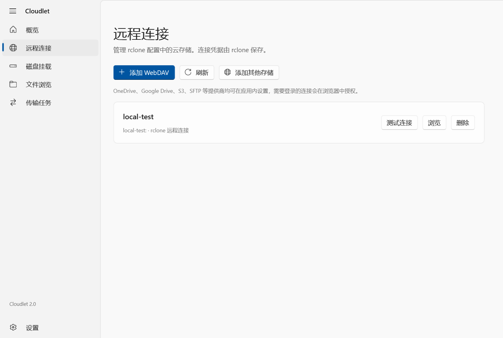
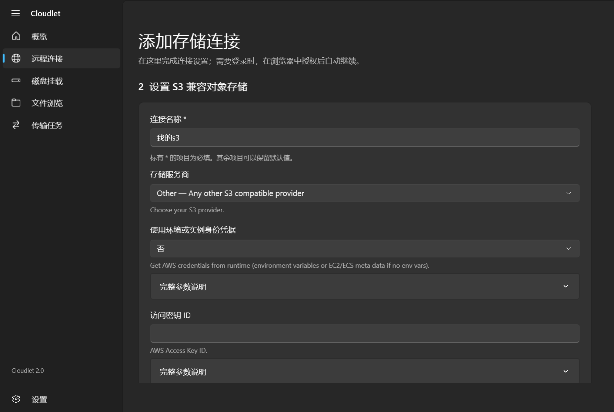

<p align="center">
  <picture>
    <source media="(prefers-color-scheme: dark)" srcset="assets/Cloudlet/icon-white.png">
    
  </picture>
</p>

<h1 align="center">Cloudlet</h1>

<p align="center">在 Windows 11 上连接云存储、挂载磁盘、浏览文件并管理传输。</p>

<p align="center">
  <a href="https://github.com/FueTsui/Cloudlet/releases/latest"></a>
  <a href="https://github.com/FueTsui/Cloudlet/actions/workflows/windows.yml"></a>
  
  <a href="LICENSE"></a>
</p>

<p align="center">
  <a href="https://github.com/FueTsui/Cloudlet/releases/tag/v2.0.0">下载 2.0.0</a> ·
  <a href="#快速开始">快速开始</a> ·
  <a href="#功能">功能</a> ·
  <a href="#从源码构建">从源码构建</a> ·
  <a href="https://github.com/FueTsui/Cloudlet/issues">反馈问题</a>
</p>

Cloudlet（原 RcloneLink）是基于 [rclone](https://rclone.org/) 的 Windows 原生桌面应用，以 C#、.NET 10 和 WinUI 3 实现。应用提供图形化连接配置、磁盘挂载、文件浏览及传输操作；安装版和便携版均包含运行所需的 .NET 组件。磁盘挂载需要 WinFsp。

## 界面预览

<p align="center">
  
  
</p>

截图来自隔离的界面验证，使用示例连接与空白凭据字段。

## 下载与安装

从 [GitHub Release v2.0.0](https://github.com/FueTsui/Cloudlet/releases/tag/v2.0.0) 下载适合的文件：

| 版本 | 文件 | 使用方式 |
| --- | --- | --- |
| 安装版 | `Cloudlet-2.0.0-Setup-x64.exe` | 运行安装器；默认安装至 `C:\Program Files\Cloudlet`，需要管理员权限。 |
| 便携版 | `Cloudlet-2.0.0-win-x64.zip` | 完整解压后运行 `Cloudlet.exe`；请保留整个应用目录。 |

当前唯一的 Tier 1 平台是 **Windows 11 x64（Build 22000 或更新版本）**。便携版仍将用户设置保存在 AppData。浏览与传输可以不安装 WinFsp；将云端目录挂载为 Windows 磁盘时需要安装 WinFsp。发布页同时提供 SHA256 校验值、内容清单和验证记录。

## 快速开始

1. 安装或解压 Cloudlet，启动 `Cloudlet.exe`。
2. 打开**远程连接**，添加 WebDAV，或通过**添加其他存储**选择提供商。需要登录的服务会在系统浏览器中完成授权。
3. 在**文件浏览**中查看远程目录；需要盘符时，先安装 WinFsp，再到**磁盘挂载**创建并启动挂载。
4. 在**传输任务**中选择复制、单向同步或校验。同步会先预演变更，确认后才实际执行。

已有旧版设置会在首次启动时导入，原设置文件保留。旧的每用户安装不会被新安装器自动卸载；若启动诊断提示旧路径，请在新版设置中重新保存登录启动。

## 功能

| 界面入口 | 主要功能 |
| --- | --- |
| 概览 | 查看 rclone、WinFsp、挂载状态，以及依赖更新和启动诊断。 |
| 远程连接 | 创建 WebDAV 连接；搜索并配置 rclone 提供商，管理已有连接。 |
| 磁盘挂载 | 创建、编辑和批量启停挂载；设置 VFS 缓存等参数，导入或导出挂载配置。 |
| 文件浏览 | 浏览远程或本地目录，查看文件及目录大小。 |
| 传输任务 | 复制、单向同步和校验；支持过滤、限速、并发、预演与取消。 |
| 设置 | 配置主题、托盘、关窗行为、登录启动、自动挂载及更新选项。 |

### 挂载、退出与更新

- “添加其他存储”先使用临时配置，最终保存时才写入实际连接；取消不会新增连接，同名连接不会被覆盖。
- 自动挂载需要同时开启设置中的全局开关和每个挂载项的“随应用自动挂载”；首次迁移后默认关闭。挂载失败最多尝试 3 次，并在界面中保留失败状态。
- 关闭窗口默认保留后台挂载。完整退出请使用托盘中的“退出并卸载磁盘”；若缓存仍有未完成的写入，应用会阻止安全卸载并提示重试。
- 2.0.0 当前发布包捆绑 rclone **1.75.1** 和 WinFsp **2.1.25156** 安装包。应用启动时及此后每 6 小时检查更新；启用自动更新后，仅在空闲时切换 rclone，并保留旧引擎与用户配置。WinFsp 安装或更新需用户主动操作并通过管理员授权。
- 兼容旧版的数据位置为 `%APPDATA%\RcloneLink\v2\state.json`。修改 rclone 配置前会备份 `rclone.conf`；备份与原文件一样可能包含连接凭据，请妥善保存。

## 从源码构建

需要 Windows 11 x64、PowerShell 7 和 `global.json` 指定的 .NET SDK 10.0.401；生成安装器还需要 Inno Setup 6。脚本会下载并校验固定版本的 rclone 与 WinFsp 安装包，不会安装驱动。SDK 从 `DOTNET_ROOT` 或 `PATH` 查找，也可通过 `-DotnetPath` 显式指定。

```powershell
./scripts/fetch-dependencies.ps1
./scripts/build.ps1
./scripts/package.ps1 -SkipBuild
```

运行包含真实 WinFsp 挂载的本地集成测试：

```powershell
dotnet run --project tests/RcloneLink.Core.Tests -c Release -- "$PWD\rclone.exe"
```

[Windows CI](https://github.com/FueTsui/Cloudlet/actions/workflows/windows.yml) 编译原生应用并运行不依赖挂载的集成测试（`--skip-mount`）；完整挂载与桌面交互仍需在目标 Windows 11 机器上验证。

## 当前状态与限制

当前发布包的 [2.0.0 发布说明](https://github.com/FueTsui/Cloudlet/releases/tag/v2.0.0)记录了 18 项核心测试和 31 个 WinUI 渲染场景。该轮未验证真实盘符挂载、Windows 重启、管理员安装与迁移、真实云账号授权；应用与安装器也未配置发行者签名。

目前没有双向同步、计划任务或跨平台版本。“添加其他存储”向导暂不支持合并加密的 rclone 配置，也不会覆盖同名连接。各提供商的可用选项以捆绑的 rclone 版本为准。

## 文档与许可

- [Windows 11 使用与构建说明](README-Windows11.md)
- [功能对照与重构说明](docs/功能对照与重构说明.md)及[早期验证报告](docs/验证报告.md)：记录 2.0 初版实现；当前依赖、安装行为和发布验证以本页及发布说明为准。
- [Core API](docs/core-api.md) · [提供商配置 API](docs/provider-api.md)
- [MIT 许可证](LICENSE) · [第三方许可声明](THIRD-PARTY-NOTICES.md)
